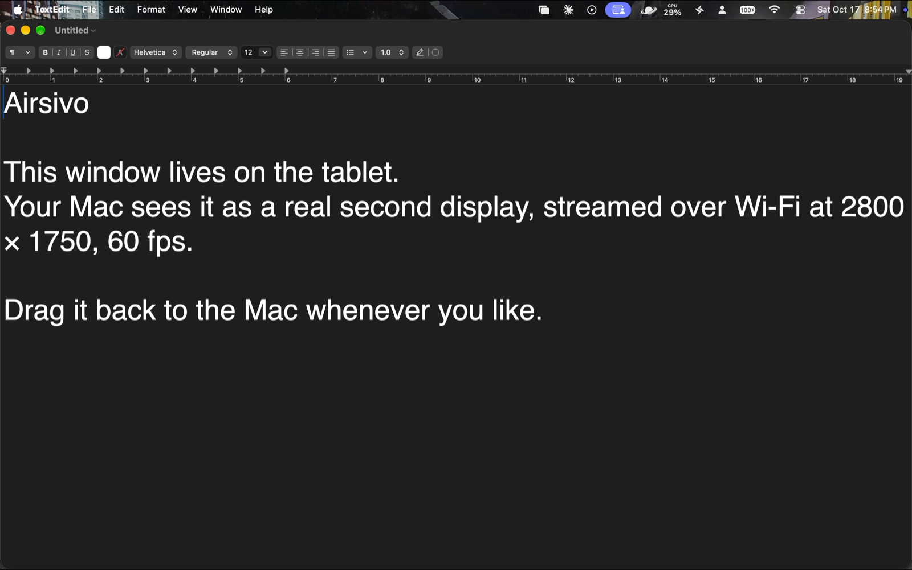
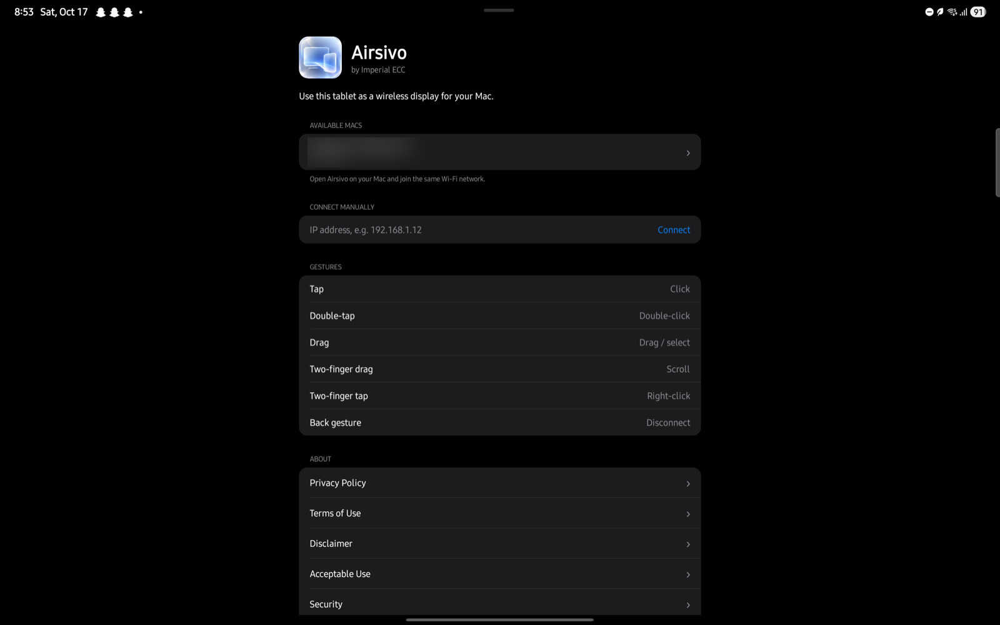
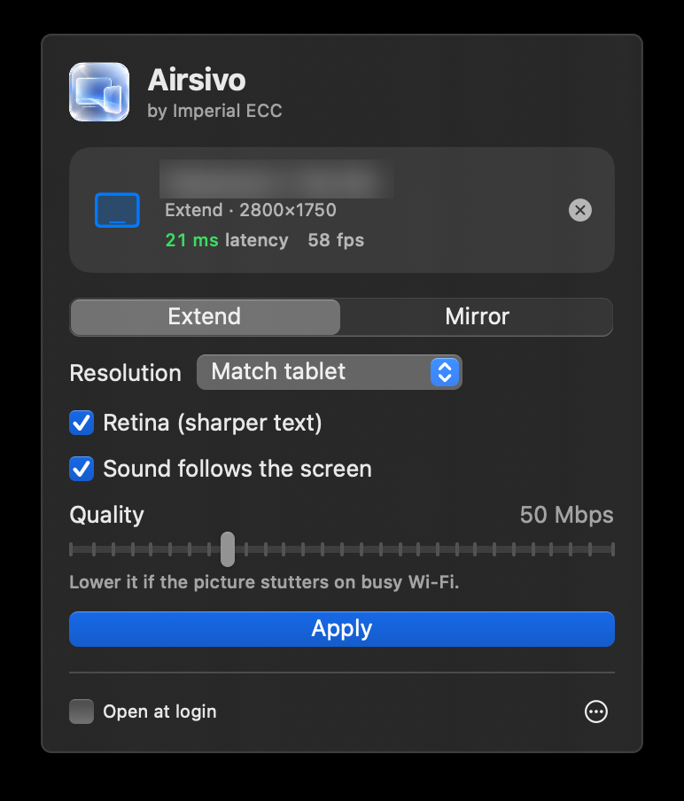
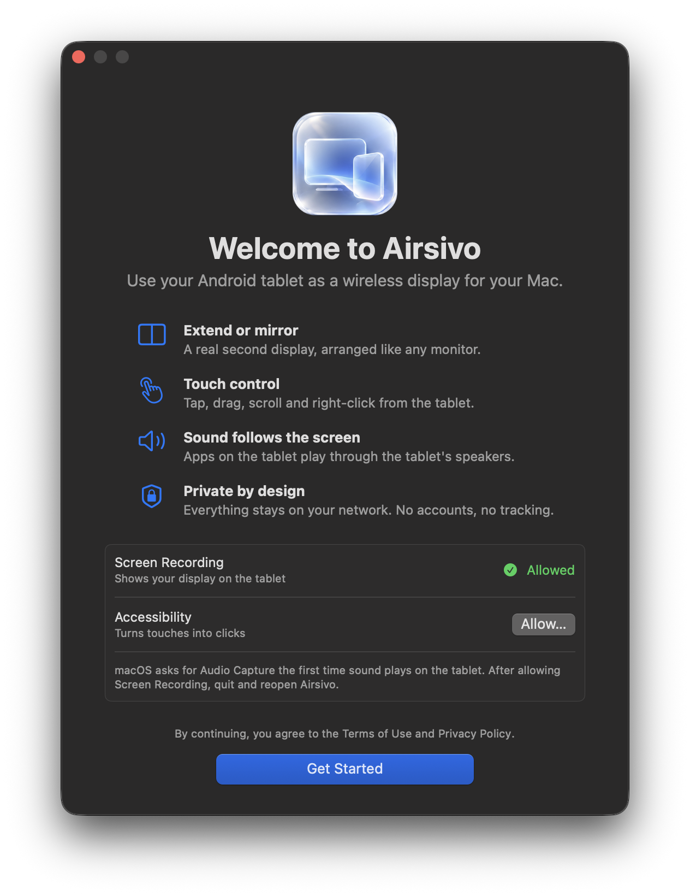
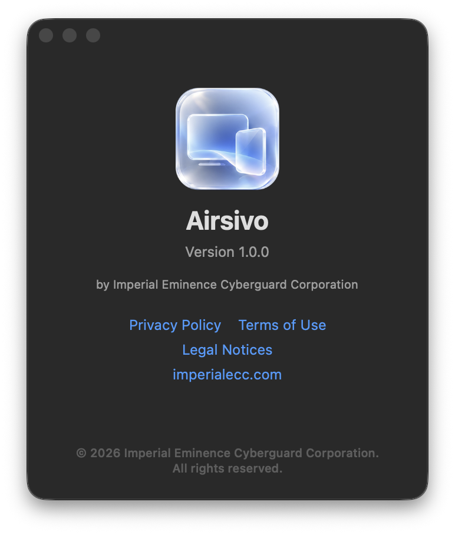
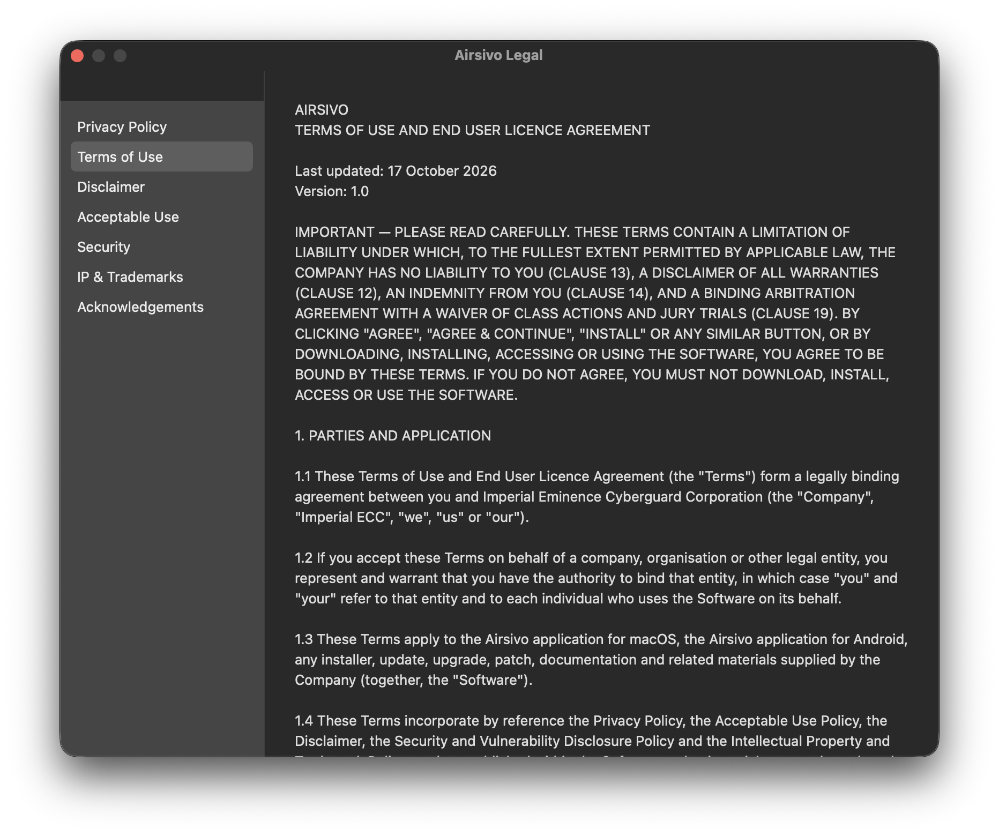
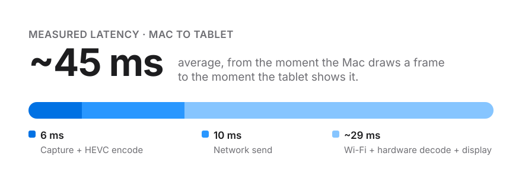

  

<h1 align="center">Airsivo</h1>

<h3 align="center">Your tablet. Your Mac's second screen.</h3>

  A wireless display for Mac, on the Android tablet you already own. 
  Extend. Mirror. Touch. Listen. No cables.

  <a href="../../releases/latest"><b>Download for Mac and Android&nbsp;›</b></a>

 

---

 

<h2 align="center">One more display. Zero more cables.</h2>

  Open Airsivo on your Mac. Open it on your tablet. Tap. 
  Your Mac sees a real second display: arrange it, drag windows onto it, and work across both.

 

  

Unedited screenshot from a Samsung Galaxy Tab S8+. That's a real TextEdit window from the Mac, running on the tablet as a second display.

 

  

The Airsivo app on the tablet finds your Mac by itself. Device name hidden for privacy.

 

---

 

<h2 align="center">Feels like it came with your Mac.</h2>

  Airsivo lives quietly in your menu bar, with native windows, native controls, and a welcome that walks you through every permission.

 

  

The menu bar panel, connected to a Galaxy Tab S8+ and showing live latency. Device name hidden for privacy.

 

  
  &nbsp;
  

  

Unedited screenshots from macOS.

 

---

 

<h2 align="center">Fast enough to forget it's wireless.</h2>

  Every frame is captured, encoded in hardware and delivered in about 45 milliseconds. 
  If your Wi-Fi hiccups, Airsivo drops a frame instead of falling behind, so the picture you see is always now.

 

  

Measured on a MacBook Pro and a Samsung Galaxy Tab S8+ at 2800 × 1750, 60 fps, over home Wi-Fi. Average across a 70-second continuous test. Results vary with your devices and network.

 

---

 

<table>
<tr>
<td width="50%" valign="top">

### Extend or mirror.
Use the tablet as a second desktop, or show exactly what's on your Mac. Switch with one click from the menu bar.

</td>
<td width="50%" valign="top">

### Touch, the way you'd expect.
Tap to click. Drag to move. Two fingers to scroll. A two-finger tap to right-click.

</td>
</tr>
<tr>
<td width="50%" valign="top">

### Sound follows the screen.
Move YouTube to the tablet and it plays from the tablet. Everything you keep on the Mac stays on the Mac's speakers. Each app, its own device.

</td>
<td width="50%" valign="top">

### Retina sharp.
Up to 4K at 60 frames per second with HEVC, matched pixel for pixel to your tablet's display.

</td>
</tr>
<tr>
<td width="50%" valign="top">

### Private by design.
No account. No cloud. No tracking. Your screen travels only between your own devices, on your own network.

</td>
<td width="50%" valign="top">

### Quietly there.
Airsivo lives in your Mac's menu bar, finds your tablet on its own, and can open when you log in.

</td>
</tr>
</table>

 

---

 

<h2 align="center">Engineered, not wrapped.</h2>

Airsivo is built directly on each platform's native frameworks. There's no web view, no Electron and no third-party code.

 

| | On your Mac | On your tablet |
|---|---|---|
| **Display** | A native virtual display, so macOS treats the tablet as a real monitor | Fullscreen hardware-accelerated rendering |
| **Video** | ScreenCaptureKit capture, encoded in real time with VideoToolbox HEVC | MediaCodec hardware decoding in low-latency mode |
| **Sound** | Core Audio process taps route each app's audio to the screen it's on | Low-latency AudioTrack playback |
| **Input** | Touches become native clicks, drags and scrolls | Multi-touch gesture recognition |
| **Connection** | Bonjour discovery and a direct local-network stream | Wi-Fi low-latency mode, so power saving never adds lag |

 

---

 

<h2 align="center">Get started in a minute.</h2>

 

**1. Download** both installers from the [latest release](../../releases/latest).

**2. Install on your Mac.** Open `Airsivo.pkg`. If macOS says it can't verify the developer, right-click the file and choose **Open**. Allow **Screen Recording** and **Accessibility** when asked, then reopen Airsivo.

**3. Install on your tablet.** Open `Airsivo.apk` and allow installation from your browser or file manager.

**4. Connect.** Join both devices to the same Wi-Fi, open Airsivo on the tablet, and tap your Mac.

 

| | Requirements |
|---|---|
| **Mac** | macOS 14.4 or later · Apple silicon or Intel |
| **Tablet** | Android 8.0 or later · HEVC hardware decoding (most tablets from 2018 onward) |
| **Network** | Both on the same Wi-Fi. 5 GHz or Wi-Fi 6 recommended for 4K |

 

---

 

  <b>Verify your download.</b> Each release lists SHA-256 checksums for both installers.

  <a href="legal/terms.txt">Terms of Use</a> ·
  <a href="legal/privacy.txt">Privacy Policy</a> ·
  <a href="legal/disclaimer.txt">Disclaimer</a> ·
  <a href="legal/acceptable-use.txt">Acceptable Use</a> ·
  <a href="legal/security.txt">Security</a> ·
  <a href="legal/ip-policy.txt">IP &amp; Trademarks</a>

  Support <a href="mailto:support@imperialecc.com">support@imperialecc.com</a> ·
  Legal <a href="mailto:legal@imperialecc.com">legal@imperialecc.com</a> ·
  Privacy <a href="mailto:Grievance@imperialecc.com">Grievance@imperialecc.com</a>

  Airsivo is not affiliated with, endorsed by or sponsored by Apple Inc., Google LLC or Samsung Electronics. 
  Mac and macOS are trademarks of Apple Inc. Android is a trademark of Google LLC. Galaxy is a trademark of Samsung Electronics Co., Ltd. 
  Copyright © 2026 Imperial Eminence Cyberguard Corporation. All rights reserved.

